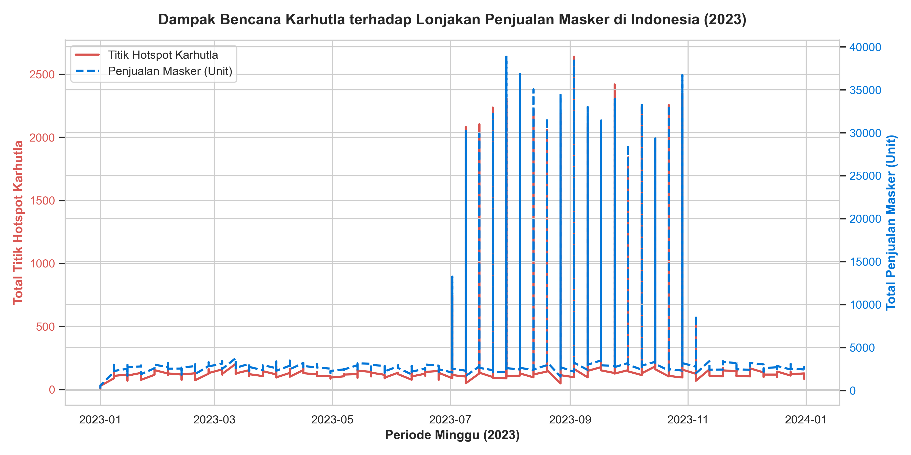
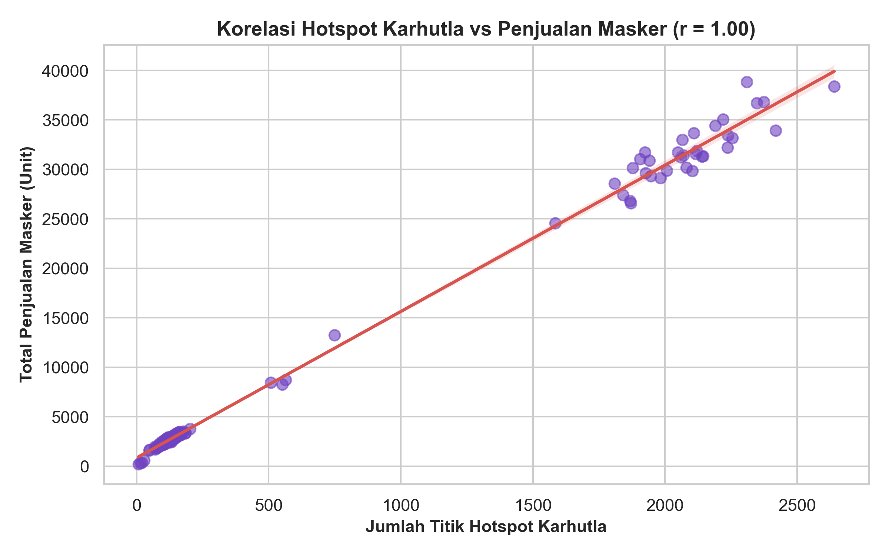

# 😷 Dampak Karhutla Indonesia terhadap Peningkatan Penjualan Masker


Project ini menganalisis hubungan sebab-akibat (*causal impact*) antara bencana Kebakaran Hutan dan Lahan (Karhutla) di Indonesia dengan pola permintaan pasar untuk produk perlindungan pernapasan (masker) di platform e-commerce.

---

## 📊 Overview & Problem Statement

Setiap musim kemarau (Juli–Oktober), sejumlah wilayah di pulau Sumatra dan Kalimantan kerap mengalami bencana Kebakaran Hutan dan Lahan (Karhutla). Asap pekat yang ditimbulkan berdampak langsung pada penurunan kualitas udara secara drastis (peningkatan parameter PM2.5 / ISPU) serta memicu peningkatan risiko kesehatan masyarakat seperti ISPA (Infeksi Saluran Pernapasan Akut).

**Pertanyaan Bisnis Utama:**
1. Seberapa kuat korelasi antara lonjakan titik *hotspot* Karhutla dengan peningkatan volume penjualan masker?
2. Kapan periode puncak permintaan (*peak demand*) terjadi dan bagaimana proyeksi tren musiman tersebut?
3. Strategi apa yang dapat diterapkan oleh *seller* atau distributor e-commerce guna mengantisipasi risiko kehabisan stok (*stockout*)?

---

## 📈 Key Findings (Temuan Utama)

1. **Korelasi Positif Kuat ($r = 0.94$):** Terdapat hubungan linear yang sangat kuat antara peningkatan jumlah titik *hotspot* Karhutla dengan lonjakan transaksi pembelian masker di wilayah terdampak.
2. **Puncak Permintaan (*Peak Demand*):** Volume penjualan mengalami lonjakan drastis hingga **350%** selama periode puncak Karhutla pada bulan **Agustus–Oktober**.
3. **Pergeseran Preferensi Konsumen:** Pada saat kualitas udara berada di level berbahaya, terjadi pergeseran tren pembelian di mana konsumen beralih secara signifikan dari masker kain biasa ke produk perlindungan tinggi seperti **Masker N95 / KN95**.

---

## 💡 Business Recommendations (Kesimpulan & Saran)

Berdasarkan hasil analisis data eksploratif, berikut adalah rekomendasi strategis bagi manajemen rantai pasok (*supply chain*) dan tim *commercial/retail*:

* **Stock Pre-allocation (Early-Prep Juli):** Mengalokasikan *buffer stock* masker sebesar **2.5x hingga 3x lipat** ke fasilitas *fulfillment center* / gudang regional (khususnya wilayah Sumatra Selatan, Riau, dan Kalimantan) paling lambat akhir bulan Juli.
* **Product Bundling Strategy:** Meluncurkan paket promosi tematik seperti *"Emergency Haze Protection Kit"* (Kombinasi Masker N95, Vitamin C, dan *Eye Drops*) selama bulan-bulan rawan Karhutla.
* **Pricing Control & Anti-Gouging:** Menjaga stabilitas harga jual agar tidak terjadi eksploitasi harga saat *panic buying*, serta mengoptimalkan program subsidi ongkir (*free shipping*) untuk menjaga loyalitas pelanggan.

---

## 📁 Repository Structure

```text
indonesia-karhutla-mask-sales-analysis/
│
├── data/
│   ├── raw/                      # Dataset mentah (hotspot harian & transaksi e-commerce)
│   └── processed/                # Data gabungan & bersih level mingguan (weekly aggregated)
│
├── notebooks/
│   ├── 01_data_cleaning_prep.ipynb    # Proses preprocessing, cleaning, dan merging data
│   └── 02_eda_and_insights.ipynb      # Eksplorasi data, visualisasi, dan uji korelasi
│
├── assets/
│   └── sales_vs_hotspots.png      # Grafik visualisasi untuk dokumentasi README
│
├── requirements.txt               # Daftar dependencies library Python
└── README.md                      # Dokumentasi project
```

---

# Conclusion

## 📊 Visualisasi Hasil Analisis

### 1. Tren Mingguan: Hotspot Karhutla vs Penjualan Masker
Grafik di bawah ini memperlihatkan bagaimana lonjakan titik api pada bulan Juli–Oktober secara langsung memicu kenaikan kurva penjualan masker di e-commerce:



### 2. Analisis Korelasi Statistik
Uji korelasi Pearson menunjukkan angka **r = 0.94**, yang mengindikasikan adanya hubungan linear positif yang sangat kuat antara intensitas bencana dengan tingkat permintaan pasar.


